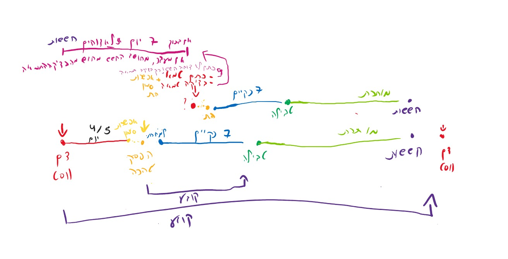

# Mikveh4U

A friendly mobile and web app that helps Jewish women keep track of the laws of family purity (הלכות נדה וטהרה) according to their tradition — and find the nearest Mikveh when it's time to immerse.



---

## What is this app?

The Jewish laws of family purity have many dates to remember each month:

- when the period (וסת) started,
- which days are considered "Niddah" (ימי נידה),
- when she may begin checking for the "Hefsek Tahara" (הפסק טהרה),
- the seven clean days (שבעה נקיים),
- the "concern" days (ימי פרישה / חששות) such as Onah Beinonit, Veset HaChodesh, etc.
- and finally the night she may go to the Mikveh.

These dates depend on the family's tradition — **Chabad** or **Sephardi**. The Sephardi option supports two calculation methods: **Rav Ovadia Yosef** and **Rav Mordechai Eliyahu**.

**Mikveh4U does all of this counting for you.** You enter the events you observed (for example: "I saw a period today" or "I made a Hefsek Tahara today"), and the app marks the upcoming relevant days on a calendar with clear Hebrew explanations.

It also uses your phone's location to show the closest Mikveh on a map.

---

## What can it do?

- **Pick your tradition** – choose Chabad, Sephardi according to Rav Ovadia Yosef, or Sephardi according to Rav Mordechai Eliyahu. The calculations change accordingly.
- **A clean Hebrew calendar** – shows both the Hebrew date and the Gregorian date.
- **Add an event with one tap**, for example:
  - וסת (start of period)
  - הפסק טהרה
  - בדיקה טמאה
  - כתם טמא
- **Automatic counting**, the app fills in:
  - the days of Niddah after the period,
  - the day from which one may start checking for Hefsek Tahara,
  - the seven clean days,
  - the days of "concern" for next month (Veset HaChodesh, Onah Beinonit).
- **Find a nearby Mikveh** – the app detects your location and shows the closest city / Mikveh on Google Maps.
- **Works on phone and web** – installable as an Android / iOS app (via Capacitor) or used in a browser.
- **Data stays on your device** – events are saved locally using Ionic Storage. Nothing personal is sent to a server.

---

## How it works (in plain words)

1. You open the app and choose your tradition (Chabad / Sephardi - Rav Ovadia Yosef / Sephardi - Rav Mordechai Eliyahu).
2. You see a calendar (Hebrew + Gregorian).
3. When something happens (period, Hefsek Tahara, etc.) you tap the day and add the event.
4. The app calculates all the rules that follow from that event for your tradition and paints them onto the calendar with short Hebrew labels like:
   - "יום 1 לנידה"
   - "אפשר להתחיל לבדוק הפסק טהרה"
   - "יום 3/7 נקיים"
   - "חשש בינונית"
5. When you need a Mikveh, the app uses your phone's GPS to suggest the nearest one.

All your events are kept on your own phone.

---

## Under the hood (for the curious / developers)

- **Framework:** [Ionic](https://ionicframework.com/) + [Angular](https://angular.dev/) (standalone components).
- **Mobile packaging:** [Capacitor](https://capacitorjs.com/) for Android and iOS.
- **Hebrew dates & locations:** [`@hebcal/core`](https://github.com/hebcal/hebcal-es6), `@hebcal/cities`, `jewish-date`.
- **Maps:** Google Maps JavaScript SDK (`@angular/google-maps`).
- **Location:** `@capacitor/geolocation`.
- **Local storage:** `@ionic/storage-angular`.
- **Hosting (web):** Firebase Hosting.

Main pieces of code:

- `src/app/pages/approaches/` – the main screen (calendar + event input).
- `src/app/services/cal.service.ts` – the halachic logic: turns an input event (Veset / Hefsek Tahara / …) into all the resulting days on the calendar, per tradition.
- `src/app/services/location.service.ts` – GPS + closest city lookup.
- `src/app/services/cache.service.ts` – stores the user's events locally.

---

## Reviewed Hebrew content

The [Google Docs review folder](https://drive.google.com/drive/folders/1IgZlGHdgqoOng1TFGq9wnfzl1t40WoB8) is the source of truth for the app's explanatory content. The rabbi edits these documents first; update the app from those edits. Do not change the review documents to match older app text.

The five documents cover Chabad, Rav Ovadia Yosef, Rav Mordechai Eliyahu, the introduction and stories. Their latest imported snapshots are in `content/google-docs/`, including document URLs and revision IDs. These are local snapshots, not a live connection to Drive. Refresh all five from the final approved documents before importing a new review: use the connected Google Docs reader for native Docs, or convert finalized Word files into the same snapshot format. Do not substitute older Drive copies for the proofread files. Preserve paragraph text, paragraph-wide bold flags, named styles, native list definitions and bullets, and every table row/cell in the snapshot structure. A paragraph is marked bold when all its nonempty text runs are bold in the source.

The existing content is complete. Batzion Shlomi (בת ציון שלומי) is professionally
proofreading the same five documents and will deliver all five finalized files
together. Phase D uses the current JSON in the meantime. Import the final approved
set together when it arrives; do not replace it with isolated interim attachments.

For an import intended for the admin publishing workflow, export a separate candidate:

```bash
python3 scripts/sync_reviewed_topics.py --output /tmp/reviewed-topics-candidate.json
```

This refuses to overwrite an existing file, leaves the bundled JSON untouched,
and never writes to Firebase. The `--write` option below updates the bundled
fallback only. It must never double as a production publishing command.
Once admin editing is available, compare each import candidate with the current
published content and review differences before explicitly publishing. Do not
automatically publish imports or replace admin drafts. If the published revision
changes during review, recheck the differences before publishing.

Import the refreshed snapshots and check for differences with:

```bash
python3 scripts/sync_reviewed_topics.py --write
python3 scripts/sync_reviewed_topics.py
```

The importer keeps the source wording, punctuation, list numbers and table markers. It normalizes whitespace for mobile display and skips empty layout paragraphs. It replaces all explanatory content, including shared introduction/stories, so omissions, duplicates and old app-only paragraphs cannot survive an import. Calendar calculations are maintained separately.

Each approach uses the same ID and content key: `chabad`, `sfarad_ovadia` (Rav Ovadia Yosef), or `sfarad_mordechai_eliyahu` (Rav Mordechai Eliyahu). Use these same keys in the approach definitions, topic data and content importer.

After importing, build and verify the app, then rebuild the Android APK. A previously generated APK still contains the content from its own build.

## Phase D — content synchronization (first increment)

`ContentSyncService` supplies the existing `CacheService.topics$` stream. It exposes
the bundled JSON immediately, restores the last valid downloaded bundle from Ionic
Storage, then checks for cloud updates in the background. Calendar initialization
does not wait for the network. No personal calendar data is uploaded.

Cloud checks are **enabled in both environment files** (`contentSyncEnabled: true`).
Production content activation was approved and completed on November 2, 2026:
`appContent/current` was initially seeded from `published/content/initial-0edd2429c759.json`, containing
the existing complete JSON content without editorial changes. The 325,259-byte
bundle has SHA-256 `0edd2429c759f426d2aeb35bb2a38d7c2b185e90979834937a6e20255bbf4cc9`.
No Hosting deployment or mobile release was performed; the local app connects to
the real Firebase project. Existing installed builds still need an app update to
acquire this synchronization mechanism.

`firestore.rules` grants public single-document reads only at `appContent/current`;
existing mikveh rules are preserved. `storage.rules` grants public single-object
downloads only for `published/content/*.json`. Client writes and content/file
listing stay denied. These rules were explicitly approved and published through
the Firebase console using `rubinshai@gmail.com`.

The bucket is in `US-CENTRAL1`. Its initially empty CORS configuration was updated
through an approved Cloud Shell session using `storage.cors.json` (GET only from
the Hosting, Capacitor and local development origins listed there). This is an
administration tool; no backend server or Function was added. Future CORS updates
must inspect the live configuration first and preserve any unrelated entries.

The read-only cloud contract is:

```text
Firestore: appContent/current
{
  "schemaVersion": 1,
  "content": {
    "version": "revision-1",
    "path": "published/content/revision-1.json",
    "sha256": "<lowercase SHA-256 of the exact uploaded JSON bytes>"
  }
}

Storage: published/content/revision-1.json
{ "schemaVersion": 1, "topics": [ ...existing topics.json format... ] }
```

Upload an immutable bundle first; update the manifest only after upload succeeds.
Paths must stay within `published/content/` and use a filename containing only
letters, numbers, hyphens or underscores followed by `.json`. A rollback points to
an older bundle; clients compare hashes rather than increasing version numbers.
The admin build contains the publisher described below; the mobile app only reads.

When enabled, startup, foreground and connectivity events trigger a single document
check, at most once per hour across launches (including failed attempts).
`ContentSyncService.refresh(true)` bypasses that interval for an explicit retry;
concurrent requests share the same work. There is no polling or realtime listener.
An unchanged SHA-256 skips the bundle download. Manifest and download waits are
bounded to 15 seconds each; the underlying Firebase SDK request may finish later,
but its late result cannot activate content after a timeout.

Downloads are limited to 2 MiB and checked for SHA-256, supported schema, the existing
10 topic IDs in their current order, all three approach keys, known block types and
rectangular tables. The order stays fixed while category/header images still use
positional bundled paths. One complete cache record is persisted before its content
is displayed. Invalid, missing, denied or interrupted updates and failed cache
writes preserve the previous content. A corrupt cache falls back to bundled JSON.
Cache keys are separate from calendar/user settings and are never written by the importer.

Content images and image-only advertisements use immutable
`published/media/<SHA-256>.jpg` paths. New media is downloaded once, checked for
size/JPEG signature/hash, and persisted with the complete bundle before activation.
The same image is reused across blocks, ads and later text revisions. View models
resolve the stored paths to local data URLs; the canonical JSON remains unchanged.
A failed image download preserves the entire previous release. Images are bounded
to 512 KiB each and at most 12 distinct images (6 MiB binary) per release.
Existing category/header artwork remains bundled and positional. Offline loading
of the web app shell (PWA) remains outside this increment.

Live verification covered public manifest reads through the Firebase SDK, exact
bundle bytes/hash, an actual browser download/cache save, and an unchanged-content
check without another bundle download. Updates happen automatically on startup and
resume (at most once an hour); the end-user interface has no update button or
technical sync status. Automated tests cover offline/corrupt/
interrupted updates with a fake cloud source and local storage. Android/iOS native
offline/relaunch verification remains required before a mobile release.

## Phase D — admin sign-in (second increment)

The admin site is a separate Angular build in the same workspace, using the existing
Firebase project and dependencies. It does not load the mobile app, calendar or
location services. Start it with `npm run admin:start` and open
`http://localhost:8200` (use `localhost`, which is an authorized Firebase Auth domain).
`npm run admin:build` builds the production site into `www-admin/browser`.
The admin interface was deployed on November 2, 2026 at
https://mikveh4u.web.app/admin/. Build it with its `/admin/` base path (the
`admin:build` script includes this flag); local `admin:start` still uses `/`.

Google sign-in was enabled in Firebase using the existing public project name
`project-136996094637` and existing support email. Only these six explicitly
approved application admins are accepted:

- `rubinshai@gmail.com`
- `shai.rubin@xorcom.com`
- `770ganani@gmail.com`
- `tsanhan@gmail.com`
- `adraha.hatanim@gmail.com`
- `hassidut.gilo@gmail.com`

Both `admin-access.ts` and the deployed `isAppAdmin()` Firestore rule require an
exact allowlisted email, a verified address and the `google.com` sign-in provider.
Keep these lists and `storage.rules` aligned when changing admins. These are application permissions;
this does not grant Google Cloud IAM or Firebase console project access.

The site opens its authenticated screen only after a successful server read of
`appAdmin/access` with `{ "enabled": true }`. That document is readable only by the
approved admins and cannot be written from a client. A missing/disabled document,
failed network check, unauthorized login or logout leaves the screen locked.
Firebase console administrators can change the availability document.

The editor is instantiated only after authorization. Other Google accounts may
authenticate with Firebase but receive no application admin access. The user authorized deployment of the admin and its publishing permissions on
November 2, 2026. The deployed Firestore and Storage rules now grant the six verified
Google admins validated publication writes and immutable content/media creation.
Further access changes require authorization.

Validation: 17 focused auth tests cover all six accounts, unauthorized/unverified/
non-Google identities, server denial, offline failure and stale account/logout
results. Firebase Rules Playground also verified all six admins are allowed and
anonymous, non-admin and unverified requests are denied.


## Phase D — simple editor, media and publishing

The admin interface has two tabs: content and advertisements. The normal workflow
is select a topic/approach, edit, and click **שמירת השינויים**. That single action
publishes the whole content bundle; there is no draft/publish workflow to learn.
Introduction and stories are shared across approaches and therefore hide the
approach selector and synchronize edits to all three copies. Other topic text is
edited per approach. Topic IDs and ordering stay fixed to preserve navigation.
Existing paragraph formatting and table structure are retained. Paragraph reorder
and removal are hidden under a small options disclosure. Ads support images only,
visibility, ordering and removal, with no targeting, links, analytics or server.
The app shows active images in a full-width, horizontally scrollable strip under
content, above topic navigation. The banner slot uses a 6:1 ratio and crops from the
center; prepare wide artwork with important text away from the edges.

Edits are remembered automatically in this browser under the signed-in admin's
email and restored on the next visit. This is an internal recovery mechanism,
not another user-facing step. Saving publishes only after the user presses the
save button. If the server version changes meanwhile, saving is blocked and the
local text is preserved for manual reconciliation. The editor never silently
replaces a newer publication. Clearing browser data removes temporary recovery.

The publisher verifies the baseline hash, uploads a new uniquely named JSON bundle,
then uses a Firestore transaction to compare the baseline again and update only
`appContent/current`. A failed upload does not move the pointer; a conflicting
transaction leaves the uploaded bundle inactive. SHA-256 comparison skips unchanged
publishes. Rollback remains possible by selecting an earlier immutable release.
Advertisements live in an optional `ads` array in the same bundle to keep this MVP
small; editing them may redownload the small JSON bundle, but unchanged images are
reused. No dependencies or infrastructure were added.

Uploaded JPG/PNG/WebP images are decoded, reduced to at most 1200 pixels on the long
side, flattened on white and re-encoded as JPEG before upload. The original file is
not stored. SVG/HTML and files above 10 MiB are rejected. Uploaded files are public
by path, including before the save button is pressed; only upload publishable
artwork. Removing an image removes its reference, not the immutable stored object.
Cloud cleanup/retention is a manual owner task for this MVP.

Deployed rules: verified Google sign-ins from the six
admins may create size/type/path-restricted JSON and JPEG objects and update the
validated publication manifest. Existing published objects cannot be overwritten
or deleted through the client. Public callers can get published JSON/JPEG by path;
listing and every unrelated Storage path remain denied. Existing Mikveh rules and
`appAdmin/access` writes remain unchanged. Firebase bucket CORS GET now also permits
the admin preview origins `http://localhost:8200` and `http://127.0.0.1:8200` under
the approved local read configuration. Hosting version `82293e409aecb997` added
only the `/admin/` build and its rewrite to the existing `mikveh4u` site, preserving
all 103 existing app files and the previous Hosting configuration. This release
used the Hosting REST API to reuse existing file hashes; the previous app itself
was not rebuilt or redeployed. Rollback is available from Hosting release history.

The repository Hosting public directory is now the actual `www/browser` output.
Before any future full-site Hosting deploy, build the app and admin and copy
`www-admin/browser` into `www/browser/admin`; a plain app build alone will omit the
admin site. Never deploy the outer `www` directory. Deploying admin files does not
update installed mobile applications.

The Google Docs importer still produces a separate candidate and never calls this
publisher. When the final five proofread documents arrive, compare the candidate
against the current published bundle and reconcile admin changes before publishing
them together. There is intentionally no one-click import-overwrite button.

Validation: focused browser unit tests cover authorization, publication ordering,
upload failure, conflicting publication, unchanged content, actual image resizing,
media reuse/offline restoration, failed image activation, automatic edit recovery
and the simplified editor. Admin production build and main development build pass.
Live hosted verification on November 2, 2026 also covered Google admin login,
server authorization, loading the published bundle, uploading an existing bundled
image, removing its content reference before publication, and saving successfully.
The verification publication preserves all original topic text and has no images
or ads in its content. A further end-to-end test temporarily changed the About
subtitle through the hosted admin, verified its automatic appearance in the normal
local app connected to real Firebase, and verified it survived reloading from the
cache. The original subtitle was then republished and the whole published topic
array was checked against the original bundled JSON. The uploaded existing
artwork remains as an immutable,
unreferenced media object for potential reuse. Native offline/relaunch testing
remains pending; browser unit coverage is not native device verification.

---

## Running the app yourself

You need [Node.js](https://nodejs.org/) (v18+) installed.

### 1. Install dependencies

```bash
npm install
npm install -g @ionic/cli   # one-time, installs the `ionic` command
```

### 2. Run in the browser (development)

```bash
ionic serve
```

This opens the app at <http://localhost:8100>.

### 3. Build for production (web)

```bash
npm run build
```

The compiled site is placed in `www/`.

### 4. Deploy the website to Firebase Hosting

```bash
firebase deploy --only hosting:mikveh4u
```

### 5. Build the Android app

```bash
npx cap sync
ionic capacitor build android
```

Run it on a connected Android device with live reload:

```bash
ionic cap run android -l --external --consolelogs
```

To inspect the device's web view from Chrome, open: `chrome://inspect/#devices`

---

## Calendar reminders (Android / iOS)

The official `@capacitor/local-notifications` v6 plugin schedules reminders from
actual calendar events, once per civil day at **09:00 in the device's local time**.
The **קבלת תזכורות מהיומן** toggle appears only in the **יומן** tab and defaults to
off on a new installation. The saved preference is preserved on updates.
Enabling requests the system permissions; disabling cancels pending reminders.
The browser displays the toggle disabled.

The collapsed **התאמה אישית** section below the master toggle stores separate
preferences for Hefsek Tahara, seven-clean-day checks, immersion, and concerns.
All four default to selected, including when upgrading an existing installation.
Only selected categories contribute to a daily reminder and its navigation
target. Disabling the last category also disables the master toggle. Enabling
the master again with no selected categories resets all four to selected.
Otherwise, switching the master off/on preserves the individual selections.
While the master is off, every category toggle appears off and is disabled;
the saved individual selections return when the master is enabled again.

Hefsek Tahara, numbered seven-clean-day checks, Mikveh night, and the monthly,
average, Haflaga and fixed-veset concerns use the same events as the calendar.
Night reminders say **הערב** and arrive on the morning before the relevant evening.
That day's actions are combined into one notification. Passed 09:00 reminders
are skipped. The nearest 60 daily reminders are queued and refreshed on launch,
resume, calendar changes, and notification delivery while the app is active.
Queued reminders can fire while the app is closed; opening the app replenishes
the queue. System permissions and device restrictions still apply.

Tapping a reminder opens the calendar and a fresh add-event form for its actual
Hebrew date and day/night onah. A combined reminder opens its first displayed
action. Opening the form does not save an event. Navigation is buffered through
cold startup and waits for the menu to finish rendering or transitioning.
Pending previews from earlier development builds are cancelled on refresh;
preview payloads are ignored when tapped. The app contains no preview generator
or notification test controls.

Android uses `SCHEDULE_EXACT_ALARM` and opens its system setting if access is
missing. For iOS, finish CocoaPods installation and build with Xcode on macOS.
These are local reminders; no notification server, APNs or FCM setup is needed.

Native launcher icons reuse `resources/icon-only.png`. Android uses its white
teardrop silhouette as the small notification icon and the original artwork as
the large icon. Regenerate native icon assets with
`node scripts/generate_app_icons.cjs`.

## Running the tests

The halachic-calculation logic in `src/app/services/cal.service.ts` (Hefsek Tahara, the seven nekiim, Mikveh day, the niddah chain, the hashashot of Onah Beinonit / Veset HaChodesh, and the cascade-delete data integrity rules) is covered by unit tests in `src/app/services/cal.service.spec.ts`.

The project uses Karma + Jasmine via the Angular CLI.

### Watch mode (during development)

```bash
npm test
```

Opens a Chrome window and re-runs the tests on every save.

### One-shot run (CI / pre-commit)

```bash
CHROME_BIN=$(which google-chrome) npx ng test --browsers=ChromeHeadlessNoSandbox --watch=false
```

The `ChromeHeadlessNoSandbox` launcher is defined in `karma.conf.js` and is the one to use on Linux / CI environments where Chrome cannot run with the default sandbox.

### Running a single spec file

```bash
CHROME_BIN=$(which google-chrome) npx ng test --browsers=ChromeHeadlessNoSandbox --watch=false --include='**/cal.service.spec.ts'
```

### Adding new tests

- Co-locate the spec next to the file under test (e.g. `foo.service.ts` ↔ `foo.service.spec.ts`).
- For services that inject `LocationService`, `CacheService`, or `ApproachService`, mirror the lightweight stubs used in `cal.service.spec.ts` rather than booting the real services (which depend on Capacitor / Storage / Geolocation).
- Use UTC-noon dates (`new Date('2025-01-10T12:00:00Z')`) when constructing input events to avoid DST-related off-by-one day diffs.

---

## Disclaimer

This app is a **helper tool only**. It is not a substitute for asking a Rav. For any real-life halachic question please consult a qualified Rabbi.
